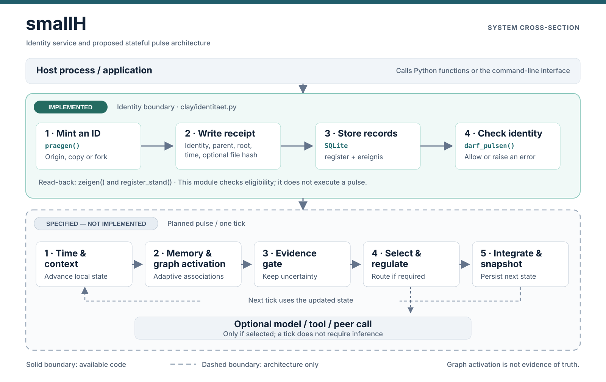

# smallH

smallH is a small Python identity registry and a design for a persistent, stateful processing loop. The intended runtime maintains an entity's continuity across processing cycles without requiring a language-model call on every cycle.

**Current status:** the repository implements identity creation, lineage records, a pre-pulse identity check, and a local status reporter. It **does not yet implement** the pulse engine, associative graph, online learning, memory curator, evidence gate, or model/tool integrations described below.

## Architecture at a glance



The upper section of the diagram shows executable code in this repository. The lower section shows the proposed processing loop. The dashed boundary is intentional: the proposed modules are not working components in this revision.

In simple terms, a host application can create and look up an identity today. A future runtime would use that identity to maintain and update its own state over time. External models or tools would be optional operations within that runtime, rather than the mechanism that drives every tick.

## What is implemented

| Component | Location | Behavior |
| --- | --- | --- |
| Identity minting | `clay/identitaet.py` | Generates a time-ordered `clay_` identifier with a random component and records it in SQLite. |
| Lineage and birth records | `clay/identitaet.py` | Stores a parent ID, lineage root, birth type, timestamps, host, optional file/state hashes, and a receipt. |
| Identity check | `clay/identitaet.py` | Rejects an unknown ID and, when a recorded body hash is available, rejects a different file hash. |
| Inspection | `clay/identitaet.py` | Returns one identity's record or aggregate counts from the local registry. |
| Status reporter | `clay/liesmich.py` | Reads local registry data, optional pulse database records, and Git metadata to produce a local report. |

The source currently contains two Python modules. There is no packaged service or running cognition loop in this repository.

## Identity: how it works

An entity receives an identifier before participating in a processing loop. The identifier is separate from the host computer, process, model, or application that uses it.

1. A caller requests a birth event through `praegen()`.
2. The function generates an ID in the form `clay_` followed by a 26-character, time-prefixed string.
3. A local SQLite transaction inserts the identity and an `ENTITY_BIRTH` event.
4. The record can be read with `zeigen()` and summarized with `register_stand()`.
5. A runtime can call `darf_pulsen()` before starting. This only performs an identity check; it does not start a runtime.

Supported birth types are `ORIGIN`, `COPY`, `FORK`, `RESTORE_SAME_LINEAGE`, `MIGRATION_SAME_LINEAGE`, `REBUILD_NEW_ENTITY`, and `IDENTITY_UNCERTAIN`. The `COPY` and `FORK` types require a parent ID present in the same registry. The parent and lineage root are retained as separate fields.

A copied instance should receive a new ID. The implementation enforces unique keys within its local database and checks a recorded file hash when available; it **cannot reliably detect every duplicate process or an identical copied file**. It is not a distributed identity authority or an authentication system.

### Stored records

The default SQLite database is `/var/lib/microclay/register.db`, configurable using `MICROCLAY_REGISTER`. It has two tables:

- `register` — one row per identity, including its parent, lineage root, birth metadata, and optional body/source-state hashes.
- `ereignis` — an event log currently used to record births.

The code appends records in normal operation. The database is **not cryptographically signed or tamper-proof**; a process with file-level write access can modify it.

The project was renamed to **smallH**. Existing `clay_` identifiers and `MICROCLAY_*` configuration keys have intentionally not been renamed in the code.

## Try the implemented part

Requirements: **Python 3.10+**, SQLite support from the Python standard library, and a POSIX-like system (`os.uname()` is used). No third-party Python packages are required by the included modules.

```bash
git clone https://github.com/gschaidergabriel/smallH.git
cd smallH

# Write the registry to a local, writable directory instead of /var/lib.
export MICROCLAY_REGISTER="$PWD/.local/register.db"

# Create an origin identity; copy the ID printed by the command.
python3 clay/identitaet.py praegen ORIGIN

# Inspect the local registry and a specific ID.
python3 clay/identitaet.py stand
python3 clay/identitaet.py zeigen "clay_YOUR_ID_HERE"
```

To register a copy or fork, supply an existing parent ID as the third argument:

```bash
python3 clay/identitaet.py praegen COPY "clay_PARENT_ID_HERE"
```

The module also exposes the functions `praegen()`, `darf_pulsen()`, `zeigen()`, and `register_stand()` to Python callers. Their source is the reference for exact arguments and error handling. Function names currently remain in German to avoid changing the existing interface.

## Proposed pulse design — not implemented

The pulse is a specification for repeated local state transitions, not a timer that automatically calls an LLM. A future implementation would roughly follow this sequence:

1. Advance time and detect timing discontinuities.
2. Verify identity and lineage before processing.
3. Read environmental changes into the local state.
4. Propagate activation across a memory/association graph.
5. Form candidate interpretations or hypotheses while retaining supporting evidence and contradictions.
6. Select relevant work and route it through regulation rules.
7. Retain unresolved alternatives rather than forcing a premature conclusion.
8. Update regulatory state.
9. Curate memory, including aging or decay.
10. Optionally call a model, tool, or peer when selected work requires it.
11. Validate and integrate any returned results.
12. Advance the epoch and write a state snapshot.

A pulse without any model call is an intended normal operating mode. No scheduling, state update, graph propagation, inference routing, or snapshot code for this loop is included yet.

### Learning and evidence boundaries

The architectural proposal reserves **one adaptive association graph** for learning from externally observed outcomes or use. Timekeeping, identity, recordkeeping, and evidence checks are intended to remain explicit procedures, not separate neural networks.

Graph activation represents relevance, **not truth**. The design calls for evidence checks, explicit unresolved alternatives, weight decay, fixed calibration cases, and rollback when calibration fails. These are design constraints, not currently tested safeguards in smallH.

## Repository structure

```text
README.md                    Project documentation
LICENSE                      MIT license
docs/smallh-architecture.svg Architecture cross-section
clay/identitaet.py           Identity registry and CLI
clay/liesmich.py             Local status reporter
```

## Local status reporting

The reporter can show counts from the registry and, if configured, an existing pulse database from the host. It does not provide a pulse engine itself.

```bash
export MICROCLAY_REGISTER="$PWD/.local/register.db"
export MICROCLAY_WURZEL="$PWD"
python3 clay/liesmich.py zeigen
```

`python3 clay/liesmich.py schreiben` updates the generated status section of the working-tree README. Its counts describe **that local host and its available databases**, not the capabilities or activity of all smallH installations. Avoid treating these local measurements as project benchmarks.

The reporter can read `MICROCLAY_PULS` (default `/var/lib/microclay/puls.db`) or a legacy pulse database if present. Those databases and pulse writers are not included in this repository.

## Scope and limitations

- **Not a standalone AI assistant.** There is no dialogue interface, model client, tool executor, or autonomous runtime here.
- **Not a secure distributed identity layer.** SQLite primary-key uniqueness applies to the configured local registry, not to disconnected registries or copied state.
- **Not a consciousness claim.** Terms such as *entity*, *memory*, and *pulse* describe software state and processing conventions, not subjective experience.
- **Not yet a validated learning system.** The planned graph and degeneration controls have no implementation or benchmarks in this repository.

## License

smallH is released under the [MIT License](LICENSE).

<!-- STATUS:START -->
<!-- Local measurements may be generated here by clay/liesmich.py. -->
<!-- STATUS:END -->
